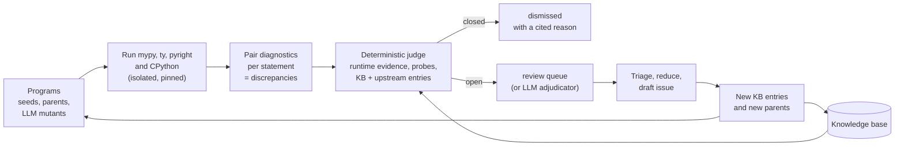

# typediff

Differential testing of Python type checkers. typediff runs **mypy**, **ty** and **pyright** on the same program, runs
the program under **CPython** as ground truth, and decides for each disagreement whether it is

- a **bug** in one of the checkers,
- a documented **design difference** or a known limitation, or
- something a **person** must look at.

It keeps a knowledge base (KB) of known differences and already reported upstream issues, so the same noise is not
triaged twice, and it can use an LLM to write the test programs. The judge itself is deterministic and needs no LLM and
no API key.

Authors: Anay Gupta, Aarsh Verma, Ajay Meena. License: [MIT](LICENSE).

## Results

The study ran the pipeline against **mypy 2.4.0, ty 0.0.97 and pyright 1.1.414** on CPython 3.13 (full report:
[results/FINAL-SUMMARY.md](results/FINAL-SUMMARY.md)).

| | |
|---|---|
| Programs checked | about 7,000: 29 hand-written seeds, 5,086 harvested from upstream test suites, and 1,880 mutants written by a model over eight rounds |
| New bugs found and verified | **12**: 4 in ty, 6 in mypy, 2 in pyright (2 crashes, 5 false negatives, 5 false positives or wrong inferences) |
| Reported upstream | **24 issues** (ty 11, mypy 9, pyright 4), all found with this pipeline. Of these, 9 are filed drafts of the 12 verified bugs (ty 4, mypy 4, pyright 1; the other 3 drafts are written up and unfiled). The other 15 come from earlier runs of the same pipeline; see below |
| Fixed upstream | Of the 12 verified bugs, 2: [ty#4934](https://github.com/astral-sh/ty/issues/4934) (ruff#30074) and [ty#4958](https://github.com/astral-sh/ty/issues/4958) (ruff#30206). Of all 24 issues, 5 are closed with a merged fix PR |
| Issues from earlier runs | 15 crash and discrepancy issues on ty, mypy and pyright, found by earlier runs of the same pipeline; they also seeded the KB. Listed in [results/FINAL-SUMMARY.md](results/FINAL-SUMMARY.md#6-other-filed-issues-from-earlier-runs-of-the-pipeline) |
| Knowledge base | 48 code entries, 27 upstream discrepancy entries, 12 crash entries, 7 prior stances |
| Calibration | First run (ty 0.0.84): 156 open bug reports, **0 of 80 ty reports** and 4 of 76 mypy reports dismissed (3 no longer reproduce, 1 is a deliberate policy). A re-run on the final KB is a different experiment: see [calibration/README.md](calibration/README.md) |
| Tests | 762 passed; `typediff kb-selftest` 20 PASS, 0 FAIL |

"Verified" means reduced, reproduced on the pinned and the newest tool versions, and searched on the trackers. It does
not mean a maintainer confirmed it. Per-bug status, links and reproducers: [results/bugs.md](results/bugs.md),
[results/verified-bugs.md](results/verified-bugs.md) and [examples/bugs/](examples/bugs/).

### Issues filed

All 24 issues authored by the three GitHub accounts were found with the typediff pipeline (LLM program generation, running
mypy, ty and pyright, CPython ground truth, the KB-filtered judge, and manual verification). The 12 "verified bugs" are
the write-ups made in the later rounds with the full verification record (reduction, version matrix, duplicate search);
9 of them are filed. The other 15 filed issues come from earlier runs of the same pipeline. States were read from the
GitHub API on 2026-11-13 (full list with labels and linked PRs: [results/bugs.md](results/bugs.md)). Counts: Fixed (merged) = closed as completed with a merged linked PR.
Fix PR open = open issue with an open linked PR. Open = open issue with no open linked PR (some have only PRs that
were closed unmerged). Closed as intended = closed as not planned. None was closed as a duplicate.

| Tool | Filed | Fixed (merged) | Fix PR open | Open | Closed as intended |
|---|---|---|---|---|---|
| ty | 11 | 4 | 3 | 3 | 1 |
| mypy | 9 | 0 | 1 | 8 | 0 |
| pyright | 4 | 1 | 3 | 0 | 0 |
| Total | 24 | 5 | 7 | 11 | 1 |

Arithmetic: 11 + 9 + 4 = 24 and 5 + 7 + 11 + 1 = 24. "Linked PR" is a pull request that cross-references the issue;
it is not always stated to be a fix, and none of the PRs was written by the three accounts.

### Contributors and accounts

Authors of the project: Anay Gupta, Aarsh Verma, Ajay Meena. The issues were filed from three GitHub accounts:
`DerekLaymn` (14 issues), `Choco-princess` (9) and `Pika-pikachu30` (1). This repository does not say which author
uses which account.

## How it works



1. Programs come from hand-written seeds, harvested upstream tests, and a model that mutates *parent* programs.
2. Each program is checked by the three tools and run by CPython in a clean temp directory.
3. Diagnostics are paired by statement. Differences become typed discrepancies (`only_mypy`, `only_ty`,
   `reveal_mismatch`, `runtime_miss`, ...).
4. A judge with no LLM closes discrepancies it can justify: a KB entry with a precise matcher, an upstream duplicate, a
   rule. CPython can veto any dismissal. Everything else stays in the review queue.
5. A person reads the queue as patterns, reduces candidates, searches the trackers, and drafts issues. Reports that
   turn out to be duplicates or design differences become KB entries; programs that showed a new pattern become parents
   for the next round.

The cost model is asymmetric: a dismissed real bug is lost for good, and a false report costs maintainer time. So
dismissal needs a checkable citation and a report needs verified strong evidence. More in
[docs/architecture.md](docs/architecture.md) and [docs/design.md](docs/design.md).

## Quick start

Requirements: Python **3.13**, `git`, and (for pyright) a network connection on first use, because the `pyright` package
downloads Node.js on first run. Linux or macOS.

```bash
git clone <this repository> typediff && cd typediff
python3.13 -m venv .venv && . .venv/bin/activate
pip install -e ".[tools,test]" -c constraints.txt     # typediff + mypy 2.4.0, ty 0.0.97, pyright 1.1.414, pytest
typediff --python-version 3.13 doctor                 # versions match the pins?
typediff fetch-docs                                   # optional: only needed to verify LLM citations
pytest -q                                             # 762 passed in about 3 minutes
typediff --python-version 3.13 kb-selftest            # 20 PASS, 0 FAIL
```

With [uv](https://docs.astral.sh/uv/): `uv venv --python 3.13 && uv pip install -e ".[tools,test]" -c constraints.txt`.

Or run all of it, including the judge on the seeds, with one command (no API key, no LLM):

```bash
scripts/reproduce.sh                  # WITH_REPLAY=1 also replays the last generation round
```

Judge the seed programs yourself. `TYPEDIFF_TOOL_MEM_MB` caps the memory of each mypy and ty process, because one seed
program (a mypy crash reproducer) makes mypy use many GB. typediff kills such a process and records a crash finding.
`reproduce.sh` sets the limit for you (Linux only).

```bash
TYPEDIFF_TOOL_MEM_MB=2048 TYPEDIFF_LLM=null typediff --python-version 3.13 --no-reduce seeds seeds/    # a few minutes
typediff triage typediff_out --top 15 --details                              # read the patterns
```

Judge one file:

```bash
typediff --python-version 3.13 run examples/known_divergences.py --keep-names
```

Expected numbers and what depends on versions: [docs/reproducibility.md](docs/reproducibility.md).

## Using an LLM (optional)

An LLM writes the programs (`generate`, `loop`) and can adjudicate discrepancies the rules leave open. Put the key in
a `.env` file in the directory where you run `typediff`:

```bash
cp .env.example .env
# edit .env:
#   TYPEDIFF_LLM=anthropic:<model>          # or openai:<model>, openai:<model>@<base-url>, file:<dir>, null
#   ANTHROPIC_API_KEY=...                   # or OPENAI_API_KEY=...
```

One generation round, then judge the new programs without an LLM:

```bash
typediff --python-version 3.13 generate --from-seeds seeds/parents --n 2 --ops union_widen --out-dir runs/gen
TYPEDIFF_TOOL_MEM_MB=2048 TYPEDIFF_LLM=null python scripts/kbloop_run.py runs/out runs/gen --jobs 4 --progress runs/progress.log
typediff triage runs/out --top 20
```

No API key? Use `TYPEDIFF_LLM=file:<dir>`: typediff writes the prompts as files and reads answers from files, which a
person or a coding agent can write. Details, variables, cost notes and settings used for the study:
[docs/llm-setup.md](docs/llm-setup.md).

## Reproducing the campaign

The generated programs depend on a model and cannot be regenerated exactly. The judge can be reproduced exactly:

- `scripts/reproduce.sh` runs the tests, the KB self-test and the judge on the seeds.
- `scripts/replay_final_round.sh` replays the last round of 250 generated programs from the 250 stored model answers,
  without an LLM, and gives the published numbers (247 discrepancies, 168 live) on the pinned versions.

Step by step: [docs/reproducibility.md](docs/reproducibility.md).

## Repository layout

```
typediff/            the package (pipeline, parsers, judge rules, KB, experiments, LLM clients, reducer, strategy)
  data/              known_upstream.json (upstream issues, crash entries, prior stances), ty_rule_map.json
seeds/               hand-written seed programs per feature area; parents/ = the 36 final parent programs
examples/
  bugs/              one reproducer per verified bug (12), with expected and actual output
  replay/            250 stored model answers and the parent programs of the last round
  known_divergences.py, needs_experiments.py, self_param_unsound.py   walkthrough programs
  ajay_examples/     40 programs probing ty's type system
calibration/         negatives, known duplicates, positives manifest, results of the calibration run
results/             final summary, per-bug reports, funnel tables, per-round reports
docs/                architecture, usage, reproducibility, LLM setup, KB guide, design
scripts/             reproduce.sh, replay, seed harvesting, parallel runner, statistics
tests/               762 tests and the reproducers they use
constraints.txt      exact versions of the checkers and test dependencies
.env.example         template for the LLM settings
```

## Documentation

| Document | Content |
|---|---|
| [docs/architecture.md](docs/architecture.md) | Components, data flow, judge algorithm, oracles, finding kinds, file bridge |
| [docs/usage.md](docs/usage.md) | Reference for every `typediff` command |
| [docs/reproducibility.md](docs/reproducibility.md) | Exact steps, versions, expected numbers, what is deterministic |
| [docs/llm-setup.md](docs/llm-setup.md) | API keys, providers, caching, file bridge, settings used for the study |
| [docs/knowledge-base.md](docs/knowledge-base.md) | How to read and add KB entries, with controls and tests |
| [docs/design.md](docs/design.md) | Design rationale: cost model, taxonomy, KB entries, calibration, worked example |
| [docs/generation.md](docs/generation.md) | Generation settings and replay of the last round |
| [results/README.md](results/README.md) | Index of the results |

## Safety

Generated programs are untrusted code and are executed by the runtime oracle. Run typediff with a model you do not
control only in a container or throwaway environment without network access.
