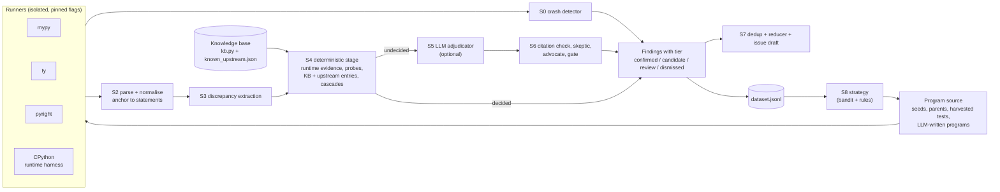
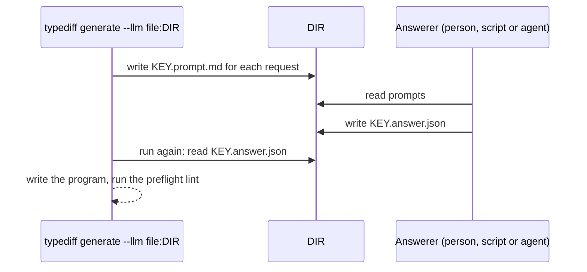

# Architecture

typediff compares what **mypy**, **ty** and **pyright** say about a Python program with what **CPython** does when it
runs the program. It decides for each disagreement whether it is a bug in a checker, a documented design difference, or
something a human must look at. This page describes the components and how data moves through them. The reasoning
behind the main decisions (cost model, taxonomy, calibration) is in [design.md](design.md). Commands are in
[usage.md](usage.md).

## Big picture



In the published campaign S5 and S6 were switched off (`TYPEDIFF_LLM=null`). Every dismissal therefore came from a KB
entry, a rule or a crash entry, and everything else stayed in the review queue for a person.

The same flow as text:

```
program.py ──► mypy, ty, pyright, CPython (isolated temp dir, pinned flags)
           ──► S0 crash detection ──► CRASH findings (dedup by signature)
           ──► S1 validity gate   ──► INVALID_TEST if the program does not parse
           ──► S2 parse + normalise + statement anchors
           ──► S3 discrepancy extraction (per statement)
           ──► S4 deterministic stage (no LLM): runtime evidence, probes, KB, cascades
           ──► S5 LLM adjudicator (optional) with allow-listed experiments
           ──► S6 citation verifier, skeptic, advocate, asymmetric gate
           ──► S7 dedup signature, delta-debugging reducer, issue draft
           ──► S8 dataset (JSONL) and strategy for the next programs
```

## Components

| Module | Role |
|---|---|
| `cli.py` | Command-line entry point: `judge`, `run`, `seeds`, `loop`, `generate`, `triage`, `fetch-docs`, `kb-selftest`, `doctor`, `calibrate`, `report`. |
| `pipeline.py` | Orchestration. `run_source` runs every tool itself; `judge_logs` takes outputs you already have. Both end in `_judge`. |
| `runners.py` | Starts mypy, ty, pyright and the CPython harness in a fresh temp directory with a clean environment (no user config, no warm cache) and a process-group kill on timeout. Holds the baseline flags. |
| `runtime_harness.py` | Runs the program under CPython with coverage, records the uncaught and the caught exceptions, and evaluates `reveal_type(x)` calls as runtime probes (`type` and `repr` of the value). |
| `parsers.py` | Parses mypy text, ty concise output, pyright JSON and tracebacks into `Diagnostic`, `Crash` and `RuntimeResult` records. Detects crashes (signals, panics, internal errors, timeouts). |
| `anchors.py` | Maps every diagnostic line to the statement that contains it (AST path), so diagnostics from different tools are compared per statement. |
| `typenorm.py` | Canonicalises revealed type strings and classifies the relation between two reveals: `equal`, `cosmetic`, `gradual`, `todo`, `x_more_precise`, `different`, `uncomparable`. |
| `display.py` | Rewrites printer conventions that differ between the tools (callables, ParamSpec scope tags, TypedDict structure) before types are compared. |
| `concerns.py`, `typediff/data/ty_rule_map.json` | Pairs a ty rule with the mypy code and pyright rule that mean the same thing, from ty's own migration table. |
| `discrepancy.py` | Builds the discrepancy list (see [kinds](#discrepancy-kinds)). |
| `rules.py` | The deterministic stage: validity, crash findings, runtime evidence, auto probes, KB matching, cascade closing. |
| `kb.py`, `typediff/data/known_upstream.json`, `crash_upstream.py`, `priors.py` | The knowledge base. See [knowledge-base.md](knowledge-base.md). |
| `experiments.py` | Allow-listed experiments: config toggles, metamorphic variants, probes, witnesses, assignability oracle, opt-in rerun, `spec_desugar`, `lsp_probe`. |
| `inhabit.py`, `selfparam.py`, `causes.py`, `origin.py`, `features.py` | Helpers: does a runtime value fit a type, the `Self`-parameter pattern, which constructs a runtime failure depends on, where a name comes from, feature tags of a statement. |
| `adjudicator.py`, `prompts.py`, `llm.py`, `corpus.py` | The optional LLM stage, its prompts, the provider clients with cache and file bridge, and the documentation corpus used to verify quotes. |
| `reducer.py` | AST delta debugging that keeps the discrepancy (and the runtime exception, if there is one). |
| `report.py` | Draft of an upstream issue for a finding. |
| `dataset.py` | `dataset.jsonl`, one record per finding, and the dedup signature. |
| `strategy.py`, `generator.py`, `operators.py` | Choosing what to generate next, the generator with its preflight lint, and the mutation operators. |
| `calibration.py` | Measures whether the rules ever dismiss a real bug. |
| `pins.py` | The single definition of the tool versions the results were produced with. |
| `replay.py`, `state.py` | Re-judge saved reports; the per-case state shared by the stages. |

## Judge algorithm

For one program:

1. **Run the tools.** mypy, ty and pyright check `case.py` in an empty directory with baseline flags (mypy
   `--check-untyped-defs --show-error-codes ...`, ty `--output-format concise`, pyright `--outputjson`). CPython runs the
   program in the harness. ty is run twice to catch non-deterministic output.
2. **Crashes (S0).** ty exit 101 or `panicked at`, a signal exit, mypy `INTERNAL ERROR` or a traceback, a pyright internal
   error, a timeout, or differing ty output between two runs becomes a `CRASH` finding (confirmed, no interpretation
   needed). If mypy or ty crashed, its diagnostics are incomplete, so discrepancy analysis is skipped for that program.
3. **Validity (S1).** A program that does not parse turns every discrepancy into `INVALID_TEST`.
4. **Discrepancies (S3).** Diagnostics are grouped by statement. Problems are paired with `same_concern` (ty rule table,
   then families). Reveals are compared with `typenorm`. Statements where CPython raised a type-related exception that no
   checker flagged become `runtime_miss`.
5. **Deterministic stage (S4).** For each discrepancy, in priority order:
   - attach runtime evidence (exception on the stack, value inside or outside the revealed type, coverage);
   - when tools may be re-run, add automatic reveal probes of the operands, the call-versus-assignability check and the
     opt-in-check rerun;
   - try the KB entries that match, automatic ones first. An entry whose matcher fires and whose `verify` experiment (if
     any) confirms it dismisses the discrepancy, unless CPython contradicts it (see
     [knowledge-base.md](knowledge-base.md#how-matching-works));
   - close cascades: a diagnostic downstream of an already dismissed rejection by the same checker.
6. **Undecided discrepancies** go to the LLM adjudicator if one is configured. Otherwise they become `review`.
7. **Prior stance and dedup (S7).** A would-be `confirmed` or `candidate` finding is capped at `review` if
   `known_upstream.json` records a similar upstream report. Crashes are closed only by a crash entry that matches tool,
   signature and program shape. Findings with a signature already in the dataset are marked `DUPLICATE`. The rest are
   reduced by delta debugging.

The asymmetric rule behind all of this: **dismiss only with a citation that can be checked; report only with strong,
verified evidence; otherwise send to a human.** Nothing is dropped silently. Every finding records `decided_by`
(`kb:<ID>`, `rule:<id>`, `llm`, `llm+experiments`, `gate`).

## Discrepancy kinds

| Kind | Meaning |
|---|---|
| `only_mypy` | mypy reports a problem at a statement, ty is silent there. |
| `only_ty` | ty reports a problem at a statement, mypy is silent there. |
| `concern_mismatch` | Both report at the statement, about unrelated things. |
| `severity_only` | Same concern, one says warning and the other error. |
| `reveal_mismatch` | `reveal_type()` results disagree. The relation field says how. |
| `reveal_unpaired` | Only one checker revealed (usually a reachability difference). |
| `runtime_miss` | CPython raised a type-related error that no checker flagged. |
| `only_pyright` | pyright reports an error where mypy and ty are silent and CPython ran the statement. Off by default; enable with `--pyright-only`. |

Pyright is otherwise a weak tie-breaker: it shares design choices with both sides, so agreement with one side never
decides a finding alone.

## Symptoms, evidence and dismissals

The classification has three independent axes (rationale in [design.md](design.md#2-taxonomy-why-three-axes)).

**Symptom** (only for a bug): `CRASH`, `FALSE_NEGATIVE` (accepts code it must reject), `FALSE_POSITIVE` (rejects code the
spec allows), `INCORRECT_INFERENCE` (wrong revealed type), `DIAGNOSTIC_DEFECT` (right decision, wrong location, message
or suppression handling).

**Evidence type** (how we know): `STACKTRACE`, `RUNTIME`, `SPEC` (verbatim, verified), `CONFORMANCE`,
`SELF_CONTRADICTION`, `DOC`, `KB`, `EXPERIMENT`, `CONSENSUS` (pyright, weak), `HEURISTIC`. The first five can be strong
evidence for a bug.

**Dismissal category** (why it is not a bug):

| Category | Meaning |
|---|---|
| `DESIGN_DIVERGENCE` | Documented, intentional behaviour of a tool. |
| `SPEC_AMBIGUITY` | The typing spec leaves it to implementations. |
| `KNOWN_LIMITATION` | Unimplemented feature or tracked check (for example ty `@Todo`, mypy join versus union). |
| `CONFIG_ARTIFACT` | Flags, Python version, opt-in checks, environment or stub (typeshed) skew. |
| `INVALID_TEST` | The generated program is broken. |
| `NOISE` | Cosmetic: wording, column, severity, equivalent type spelling. |
| `DUPLICATE` | Same root cause already in the dataset or reported upstream. |

**Tier** of a finding: `confirmed` (report-ready after reduction), `candidate` (probably a bug, glance first), `review`
(human queue), `dismissed` (with a cited reason). A finding also carries `verdict`, `faulty_tool` (`ty`, `mypy`, `both`,
`none`), `confidence`, evidence items, reviewer notes, a dedup signature and, when reduced, a minimal repro.

## Oracles

Where ground truth comes from, strongest first:

| Oracle | Catches | Strength |
|---|---|---|
| Crash, timeout, repeat-run difference | Engine failures | Strong, no interpretation needed. |
| CPython exception with the statement on the stack | A silent checker (false negative); confirms a reporting checker | Strong. Check the cause: `Any` paths can hide it. |
| Runtime value outside the revealed type (`inhabit.py`) | Incorrect inference | Strong. Only a definite "no" is used. |
| Coverage: an executed line has no reveal in tool X | A checker treats reachable code as unreachable | Medium. |
| Call versus assignability self-consistency | A tool rejects `_: X = value` but accepts `f(value)` for `f(c: X)` | Strong for a declared signature, weak for a printed bound method that involves `Self` or a TypeVar. |
| Metamorphic variants (`pep604`, `pep585`) | Behaviour that depends on spelling | Strong. |
| Gradual guarantee (`any_substitution`) | New errors after replacing a type with `Any` | Strong. |
| Config toggle (strict equality, strict generic narrowing, opt-in mypy codes) | Confirms a KB "design" explanation | Strong for dismissal. |
| Opt-in soundness rerun (mypy `mutable-override`, ty `unsound-*`) | A deliberate default versus no mode that catches it | Medium. |
| `spec_desugar`, `lsp_probe` | Whether a `Self` reading is consistent with the spec's desugaring | Weak hints, never a dismissal alone. |
| Witness (LLM-written code that must crash) | Turns a spec argument into a runtime proof | Strong. |
| pyright agreement | Consensus | Weak. |

## The knowledge base

The KB is the list of reasons a discrepancy may not be a bug. It has three parts:

- `typediff/kb.py`: entries with matcher functions, optional verifying experiments and a canonical example.
- `typediff/data/known_upstream.json`: already reported upstream issues, crash entries and prior stances.
- `calibration/`: programs that test the entries from outside.

Entries come in three trust levels: **hint only** (shown to the LLM, never dismisses), **automatic** (dismisses when a
precise matcher fires), and **automatic with verification** (dismisses only after an experiment shows the discrepancy
disappears under the documented toggle). By default CPython can veto an entry (`runtime_override`). Full reference:
[knowledge-base.md](knowledge-base.md).

## LLM adjudication and the gate

Only discrepancies the deterministic stage left open reach the model (up to 8 per batch, up to 3 rounds). In each round
the model sees the program, the tool outputs, runtime facts, KB hints and retrieved spec or documentation chunks, and
returns a JSON judgment. typediff then:

- verifies `SPEC` and `DOC` quotes against the downloaded corpus (`typediff fetch-docs`); an unverifiable quote is
  discarded and the verdict downgraded;
- checks that cited KB ids matched and cited experiments exist;
- runs requested experiments (flags, side-effect-free probes) and re-asks;
- runs a **skeptic** (a maintainer role that must cite a source for "working as intended") against every bug verdict, and
  an **advocate** against weak not-a-bug verdicts and against sampled KB dismissals (`--audit-rate`, default 5 %).

The gate then assigns the tier:

| Condition | Tier |
|---|---|
| Bug, strong verified evidence, confidence at least 0.85, skeptic not opposed | `confirmed` |
| Bug, strong verified evidence, confidence at least 0.60, skeptic not opposed | `candidate` |
| Not a bug, verified dismissal evidence, confidence at least 0.85, advocate upholds | `dismissed` |
| Anything else | `review` |

## Search strategy

`strategy.py` keeps statistics for each of 24 feature areas (generics and variance, ParamSpec, TypedDict, overloads,
narrowing, `match`, `Self`, descriptors, recursive aliases, context managers, and others). A UCB1 bandit picks areas.
Hard rules the LLM cannot override: continue on a bug candidate, repair the generator when at least half of the last four
programs were invalid, abandon an area dominated by known limitations, pivot when the last five cases reproduced at most two KB entries or
showed no disagreement. The mutation operators (`typediff/operators.py` and the names listed in [design.md](design.md#6-search-strategy))
tell the generator how to change a parent program.

In the published campaign the loop was driven by hand: after each round the authors promoted programs that showed a new
pattern to the parent set (`seeds/parents/`), retired parents that only reproduced known findings, and chose the areas and
operators for the next round.

## File bridge for LLM generation

The `file:<dir>` provider turns the LLM interface into files so a person, a script or a coding agent can answer.



`KEY` is the first 16 hex characters of `sha256(system prompt + user prompt + seed)`. Because the prompts are built
deterministically from the parent program, operator and variant number, the same command regenerates the same keys, so
stored answers can be replayed without a model. `scripts/inbox_check.py` reports prompts without answers and answers
without prompts. Details: [llm-setup.md](llm-setup.md#the-file-bridge-filedir).

## Outputs

| File | Content |
|---|---|
| `typediff_out/<case>.json` | Full machine-readable report of one program (source, diagnostics, runtime result, discrepancies, findings). |
| `typediff_out/<case>.md` | Human-readable summary of the same report. |
| `typediff_out/dataset.jsonl` | One record per finding, with the dedup signature. |
| `typediff_out/strategy.json` | Per-area statistics (written by `loop` and `seeds`). |

The output directory is set with `--out` (default `typediff_out`). It is git-ignored.

## Limits

- The runtime oracle sees only the executed path. A runtime success never proves a rejection is spurious.
- `inhabit.py` decides builtins, literals, enums, containers and nominal user classes. Protocols, TypeVars and callables
  return "unknown".
- KB entries are version specific. Re-run `typediff kb-selftest` after every checker upgrade (ty is `0.0.x` and changes
  quickly) and `typediff fetch-docs --refresh-rule-map` to refresh the rule table.
- Generated programs are untrusted code. Run the harness in a container without network access.
